# Awesome Cloud Telephony & PBX Integration ☎️

  

  
  
  
  
  

> 🌐 A curated directory of leading Cloud Telephony platforms, Cloud PBX systems, Business VoIP, Unified Communications as a Service (UCaaS), and Open-Source SIP/Telephony infrastructure for enterprise developers, IT administrators, and DevOps engineers.

Cloud telephony and hosted PBX systems replace legacy, on-premise telecom hardware with scalable, software-driven voice architectures over the internet. These solutions power modern call centers, programmable voice APIs, Interactive Voice Response (IVR) systems, SIP trunking, call routing, SMS/messaging, and business phone infrastructure.

---

## 📑 Table of Contents

- [🌐 Overview](#-overview)
- [📈 Sector Overview & Market Dynamics](#-sector-overview--market-dynamics)
- [💡 Key Benefits of Cloud PBX & Cloud Telephony](#-key-benefits-of-cloud-pbx--cloud-telephony)
- [☁️ SaaS & Hosted Business VoIP Platforms](#️-saas--hosted-business-voip-platforms)
- [💻 Open-Source PBX & SIP Infrastructure Projects](#-open-source-pbx--sip-infrastructure-projects)
- [🏗️ Architecture & Integration Frameworks](#️-architecture--integration-frameworks)
- [🤝 How to Contribute](#-how-to-contribute)
- [🔒 Security & Compliance Disclaimer](#-security--compliance-disclaimer)
- [⭐ Star History](#-star-history)
- [💖 Support](#-support)

---

## 🌐 Overview

Whether you are designing a contact center from scratch, migrating an office from traditional landlines to VoIP, or integrating programmable telephony into a web or mobile application, this repository serves as a vendor-neutral resource comparing commercial SaaS products and open-source self-hosted solutions.

---

## 📈 Sector Overview & Market Dynamics

The global Cloud Telephony and UCaaS (Unified Communications as a Service) market is estimated at **$60B+ to $85B+** (projected to surpass **$140B+ by 2030** at an ~11–13% CAGR), driven by remote-first enterprise workforces, PSTN sunsetting, and the rapid embedding of conversational AI into customer support workflows. The sector is **moderately fragmented**: mega-cap tech conglomerates and dedicated communications giants (e.g., Zoom, RingCentral, Cisco Webex, Microsoft Teams) capture outsized enterprise seat share, while a competitive tier of specialized mid-market VoIP providers (Dialpad, Nextiva, 8x8, Talkdesk) and open-source telecom engines (Asterisk, FreeSWITCH, Kamailio) prevent a winner-take-all monopoly and foster continuous protocol-level innovation.

---

## 💡 Key Benefits of Cloud PBX & Cloud Telephony

- 💰 **Cost Efficiency**: Eliminates expensive proprietary on-premise PBX hardware and costly maintenance contracts.
- 🌍 **Global Scalability**: Instantly provision virtual phone numbers (DID), SIP trunks, and call channels across multiple countries.
- 📱 **Remote & Hybrid Work Readiness**: Softphone clients, WebRTC endpoints, and mobile apps enable distributed teams to stay connected anywhere.
- 🔄 **Rich Integration**: Seamless API-level connections with popular CRM tools (Salesforce, HubSpot, Zoho), helpdesks (Zendesk, Freshdesk), and productivity suites (Google Workspace, Microsoft 365).
- ⚙️ **Advanced Call Management**: Out-of-the-box support for multi-level IVR, automatic call distribution (ACD), call recording, voicemail-to-email transcription, and real-time analytics.

---

## ☁️ SaaS & Hosted Business VoIP Platforms

The table below highlights industry-leading Cloud PBX and Unified Communications as a Service (UCaaS) providers, sorted in descending order by company size (market capitalization / enterprise valuation or revenue tier), including exact starting tier prices and explicit free tier or trial limits.

| Product | Company Size (Valuation / Revenue) | Description | Pricing (Starting) | Free Tier / Trial Limits |
|---|---|---|---|---|
| **[Zoom Phone](https://www.zoom.us/)** | ~$22 Billion Market Cap | Modern cloud phone system natively integrated with Zoom Meetings and Team Chat, featuring Zoom AI Companion for call summaries. | Metered Plan: $10.00/user/month (or $120.00/user/year); Unlimited US/CA: $15.00/user/month | No permanent free tier; 30-day free trial available for qualified enterprise business accounts upon sales request. |
| **[Talkdesk](https://www.talkdesk.com/)** | ~$10 Billion Private Valuation | AI-powered enterprise cloud contact center platform (CCaaS) offering intelligent call routing, agent assist, and omnichannel engagement. | Voice Essentials: $105.00/user/month; Digital Essentials: $85.00/user/month | **Talkdesk Express**: Free tier with 25 licenses + $100.00 free credit for companies under 50 employees; 14-day free trial on standard plans. |
| **[Zoho Voice](https://www.zoho.com/voice/)** | ~$1.2 Billion Annual Revenue (Bootstrapped) | Programmable business phone system and cloud telephony tightly integrated with Zoho CRM, Zoho Desk, and Zoho ecosystem apps. | Basic: $10.00/user/month (annual billing) or $12.00/user/month (monthly); Standard: $18.00/user/month | **Solo (Free Forever Plan)**: 1 user, 250 free outgoing minutes/month; 15-day free trial for paid tiers with full feature access. |
| **[RingCentral MVP](https://www.ringcentral.com/)** | ~$2.8 Billion Market Cap (~$2.2B Annual Revenue) | Enterprise unified communications offering RingEX plans bundling unlimited domestic calling, video meetings, team messaging, and SMS. | Core: $20.00/user/month (annual billing for 1–100 users) or $30.00/user/month (monthly); Advanced: $25.00/user/month | No permanent free plan; **14-day free trial** for up to 5 users including 50 minutes of domestic outbound calling per user. |
| **[Nextiva](https://www.nextiva.com/)** | ~$2.7 Billion Private Valuation (~$400M+ ARR) | Business VoIP platform featuring enterprise call routing, team collaboration, conversational AI tools, and CRM integrations. | Digital Plan: $15.00/user/month; Core Voice: $19.95/user/month (annual billing, scales by user volume) | No permanent free plan; **7-day free trial** available for up to 5 users with standard PBX calling features. |
| **[Dialpad](https://www.dialpad.com/)** | ~$2.2 Billion Private Valuation (~$300M+ ARR) | AI-driven cloud telephony and unified communications suite providing real-time transcription, live sentiment analysis, voice, and video. | Standard: $15.00/user/month (annual billing) or $23.00/user/month (monthly); Pro: $25.00/user/month | No permanent free plan; **14-day free trial** with full platform capabilities and 1 phone number for testing. |
| **[GoTo Connect](https://www.goto.com/)** | ~$1.0 Billion+ Annual Revenue (GoTo Group) | Unified communications system combining customizable cloud phone routing, virtual receptionist, video conferencing, and multi-country calling. | Basic / Phone System: $26.00/user/month (annual billing) or $32.00/user/month (monthly) | No permanent free tier; **14-day free trial** with full admin portal access and softphone evaluation. |
| **[8x8 X Series](https://www.8x8.com/)** | ~$350 Million Market Cap (~$740M Annual Revenue) | Cloud communications and contact center platform spanning multiple tiers featuring international calling and integrated video meetings. | Express: $15.00/user/month; X2 Work: $24.00/user/month (annual billing) | No permanent free tier; **30-day free trial** for 8x8 Express including business phone numbers and mobile/desktop apps. |
| **[Vonage Business Communications](https://www.vonage.com/)** | ~$250 Million+ Division Revenue (Ericsson Subsidiary) | Flexible cloud PBX with cross-platform desktop/mobile apps, team messaging, multi-level auto attendant, and deep CRM integration. | Mobile: $13.99/line/month (12-month promotional rate) or $19.99/line/month regular; Premium: $20.99/line/month | No permanent free plan; **14-day free trial** offered on select business lines upon sales onboarding. |
| **[Ooma Office](https://www.ooma.com/)** | ~$220 Million Market Cap (~$250M Annual Revenue) | Plug-and-play business VoIP tailored for small to mid-sized businesses with mobile apps, virtual receptionist, and unlimited calling in North America. | Essentials: $19.95/user/month; Pro: $24.95/user/month; Pro Plus: $29.95/user/month | No permanent free tier; **30-day risk-free money-back guarantee** on hardware and service subscriptions. |

---

## 💻 Open-Source PBX & SIP Infrastructure Projects

For system administrators, telecom engineers, and DevOps teams seeking complete data sovereignty, zero per-seat licensing fees, and self-hosted high-throughput telecom infrastructure.

The projects below are sorted in descending order by GitHub_Stars_Counts:

| Project | Stars_Badge | Category / Focus | Description |
|---|---|---|---|
| **[Jitsi Meet](https://github.com/jitsi/jitsi-meet)** |  | Video Conferencing & WebRTC PBX Gateway | 100% open-source WebRTC video conferencing platform supporting SIP phone dial-in and dial-out via Jigasi integration. |
| **[LiveKit](https://github.com/livekit/livekit)** |  | Programmable Voice, Video & SIP Stack | End-to-end WebRTC and SIP stack for building real-time audio, video, and AI voice agents with native SIP telephony bridging. |
| **[coturn](https://github.com/coturn/coturn)** |  | VoIP & WebRTC NAT Traversal | High-performance open-source TURN and STUN server essential for VoIP and WebRTC media relay across enterprise NATs and firewalls. |
| **[Fonoster](https://github.com/fonoster/fonoster)** |  | Programmable Cloud Telephony (Twilio Alt) | Open-source alternative to Twilio. Programmable telecom platform enabling developers to build IVR, call routing, and voice applications via APIs. |
| **[FreeSWITCH](https://github.com/signalwire/freeswitch)** |  | Telecom Application Server | High-performance, software-defined telecom stack powering PBX, conferencing, WebRTC gateways, and media switching from edge nodes to cloud clusters. |
| **[Asterisk](https://github.com/asterisk/asterisk)** |  | PBX Engine & Telephony Toolkit | The foundational open-source PBX engine. Manages VoIP routing, SIP trunks, IVRs, automated call queues, voicemail, and telecom protocol bridging. |
| **[Kamailio](https://github.com/kamailio/kamailio)** |  | SIP Proxy / SBC / Router | Enterprise-grade SIP server handling thousands of call setups per second. Ideal for load balancing, carrier-grade SIP routing, and telecom security. |
| **[PJSIP](https://github.com/pjsip/pjproject)** |  | SIP & Multimedia Library | Modern C-based SIP, SDP, RTP, RTCP, and STUN/TURN/ICE stack powering mobile softphones, embedded IoT devices, and telephony server backends. |
| **[HOMER](https://github.com/sipcapture/homer)** |  | VoIP/RTC Monitoring & PCAP | Robust packet capture, protocol visualization, and QoS/QoE monitoring platform for troubleshooting SIP, RTCP, and WebRTC network traffic. |
| **[OpenSIPS](https://github.com/OpenSIPS/opensips)** |  | SIP Proxy & Application Server | Ultra-fast, highly modular SIP proxy/server for carrier VoIP solutions, wholesale termination, session border controller (SBC) roles, and presence. |
| **[FusionPBX](https://github.com/fusionpbx/fusionpbx)** |  | Multi-Tenant PBX GUI | Comprehensive web-based administration frontend and multi-tenant management platform built specifically on top of FreeSWITCH. |
| **[rtpengine](https://github.com/sipwise/rtpengine)** |  | Media Proxy & Transcoding Relay | High-throughput RTP/SRTP and WebRTC audio/video proxy kernel-module proxy maintained by Sipwise for Kamailio and OpenSIPS setups. |
| **[Linphone Desktop](https://github.com/BelledonneCommunications/linphone-desktop)** |  | Open-Source SIP Softphone Client | Cross-platform VoIP and video softphone client supporting modern audio/video codecs, encryption (ZRTP/SRTP), and standard SIP accounts. |
| **[Drachtio Server](https://github.com/drachtio/drachtio-server)** |  | Node.js Programmable SIP Server | High-performance C++ SIP application server that allows developers to control SIP signaling directly using Node.js applications. |

---

## 🏗️ Architecture & Integration Frameworks

A production-ready, vendor-neutral telecom stack frequently pairs these open-source building blocks:

- 🛡️ **Edge Layer (SBC & Security)**: [Kamailio](https://github.com/kamailio/kamailio) or [OpenSIPS](https://github.com/OpenSIPS/opensips) for DDoS protection, SIP firewalling, TLS/SRTP termination, and carrier trunk load balancing.
- ⚙️ **Media & PBX Layer**: [FreeSWITCH](https://github.com/signalwire/freeswitch) or [Asterisk](https://github.com/asterisk/asterisk) handling call logic, IVR trees, conferencing, transcoding, and voicemail.
- 🎛️ **Management & Provisioning**: [FusionPBX](https://github.com/fusionpbx/fusionpbx) providing multi-tenant administration, user extension self-service, and CDR reporting.
- 📡 **Media Relay & NAT Traversal**: [rtpengine](https://github.com/sipwise/rtpengine) for kernel-level media forwarding and [coturn](https://github.com/coturn/coturn) for WebRTC ICE negotiation.
- 📊 **Observability & Analytics**: [HOMER](https://github.com/sipcapture/homer) for continuous SIP call trace inspection, RTP packet loss analysis, and jitter diagnostics.

---

## 🤝 How to Contribute

We welcome additions, updates, and corrections from the VoIP, UCaaS, and open-source telephony communities!

1. 🍴 **Fork** this repository.
2. 🌿 **Create a branch**: `git checkout -b feature/add-new-telephony-tool`.
3. 📝 **Add or edit entries**: Ensure entries follow the existing tabular format with specific pricing/trial details, accurate company valuation, and Stars_Counts.
4. 🚀 **Commit & Push**: Submit a concise Pull Request describing the tool and its ecosystem relevance.

---

## 🔒 Security & Compliance Disclaimer

- 🔐 **Telephony Security**: Self-hosted VoIP and PBX systems must implement strict firewall rules, SIP authentication protections (e.g., fail2ban), TLS signaling, and SRTP media encryption to protect against toll fraud and unauthorized routing.
- 📜 **Regulatory Compliance**: Voice recording, automated dialing, and telecommunication services are subject to federal and international laws (such as GDPR, HIPAA, STIR/SHAKEN, TCPA, and two-party consent regulations). Always ensure administrative safeguards before enabling recording or dialer workflows.
- 🔍 **Accuracy**: Pricing models, subscription tiers, and feature sets change frequently. Always consult the respective official vendor or project documentation for real-time specifications.

---

##  Star History

---

## 💖 Support

Thank you for exploring and utilizing the **Awesome Cloud Telephony & PBX Integration** ecosystem! If you find this curated collection helpful for your business telephony architecture, self-hosted PBX setups, or VoIP development projects, please consider supporting the project:

- ⭐ **Star this repository** to help other developers and VoIP architects discover it!
- 🍴 **Fork and contribute** your favorite cloud telephony tools and open-source stacks.
- 📢 **Share** with your network, team, and tech communities on Discord, LinkedIn, or Twitter/X.
- ☕ **Buy a coffee**: Support ongoing curation and maintenance via the [GitHub Sponsor Dashboard](https://github.com/sponsors/ishandutta2007).
